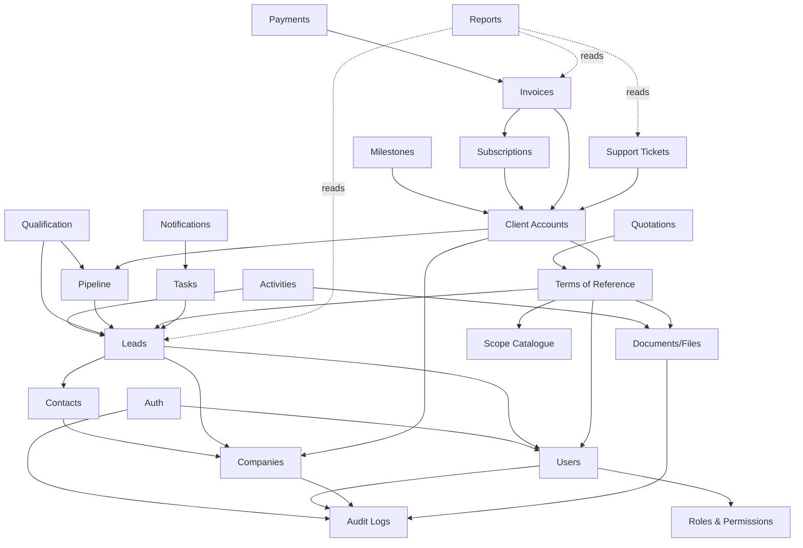

# 02 — Architecture

## Style

**Modular monolith**: one NestJS deployable, one PostgreSQL database, modules with explicit ownership of their data and an explicit dependency direction. No microservices ([ADR-001](decisions/ADR-001-modular-monolith.md)).

```
Browser ──> apps/web (Next.js) ──REST──> apps/api (NestJS) ──Prisma──> PostgreSQL
                                              │
                                              └── (later) apps/worker for scheduled jobs
```

## Layers inside each backend module (applied pragmatically)

| Layer          | Contains                                                           | Rule                                                            |
| -------------- | ------------------------------------------------------------------ | --------------------------------------------------------------- |
| Presentation   | Controllers, request/response DTO schemas                          | Thin: validate, authorize, call a use case, map result          |
| Application    | Use cases / services orchestrating a business action, transactions | One class per meaningful action; no HTTP types                  |
| Domain         | Business rules, state machines, value objects                      | Pure TypeScript, no Nest/Prisma imports; unit-testable          |
| Infrastructure | Prisma repositories, external providers (email, PDF, storage)      | Only layer that imports Prisma. Providers sit behind interfaces |

Trivial CRUD does **not** get all four layers: a module may start with controller + service + Prisma access and grow a domain layer when real rules appear. The first module to need a domain layer is Qualification/ToR.

Today only `PrismaModule`, `HealthModule` and `common/` exist. The module folder convention is `apps/api/src/modules/<name>/{presentation,application,domain,infrastructure}` (created per module, not in advance).

## Boundaries (enforced by review, and by lint where possible)

- Prisma types never cross into `apps/web` or shared packages. The generated client lives in `apps/api/src/generated` (git-ignored, produced by `prisma generate`).
- `packages/contracts` holds **API shapes** (types only). It does not replace server-side validation; runtime schemas live in the API (zod) and shared primitives in `packages/validation`.
- Authorization is enforced by the API on every route; frontend guards are UX only.
- A module reads another module's data through that module's exported service, not by querying its tables.
- External integrations (email, PDF, storage, M-Pesa, …) are interfaces in the application layer with adapters in infrastructure.

## Module dependency map

Arrows point at what a module may depend on. No cycles.



Key design consequences:

- **Pipeline** owns the allowed stage transitions; Leads stores the current stage, Qualification and ToR _request_ a transition rather than writing the stage.
- **Client conversion** lives in Client Accounts (Phase 6) and is the only code path that creates a client; it verifies both ToR signatures inside one transaction and is idempotent.
- **Reports** are read-only and never imported by other modules.
- **Audit** is a leaf: everyone writes to it, it depends on no one.

## Cross-cutting conventions (implemented in Phase 0)

| Concern                 | Implementation                                                                                                                     |
| ----------------------- | ---------------------------------------------------------------------------------------------------------------------------------- |
| Config                  | `@nestjs/config` + zod schema (`apps/api/src/config/env.ts`); invalid env aborts startup                                           |
| Logging                 | `nestjs-pino`, JSON in production / pretty in dev, `x-request-id` propagated and echoed, `authorization`/`cookie` headers redacted |
| Errors                  | One envelope (`ApiErrorBody` in contracts) via `ApiExceptionFilter`; unknown errors are logged, never leaked                       |
| Validation              | `StandardSchemaValidationPipe` + zod schemas on `@Body/@Query/@Param`                                                              |
| Security headers / CORS | `helmet`, allow-list from `CORS_ORIGINS`                                                                                           |
| API docs                | `@nestjs/swagger` at `/api/docs`, JSON at `/api/docs-json`                                                                         |
| Health                  | `GET /api/v1/health/live`, `GET /api/v1/health` (DB ping)                                                                          |
| Versioning              | URL prefix `/api/v1`                                                                                                               |

## Infrastructure

`docker-compose.yml`: `postgres` (default) plus `api` and `web` under the `app` profile. Day-to-day development runs apps on the host with hot reload against the compose database. Dockerfiles: `infrastructure/docker/{api,web}.Dockerfile` (multi-stage, non-root).

## Technology notes (versions verified at setup, Nov 2026)

NestJS 12 is **ESM-only** (relative imports end in `.js`, Vitest not Jest); Prisma 7 uses the `prisma-client` generator, a driver adapter (`@prisma/adapter-pg`) and `prisma.config.ts` (it no longer reads `.env` itself); Next.js 16; TypeScript 6; Zod 4.
