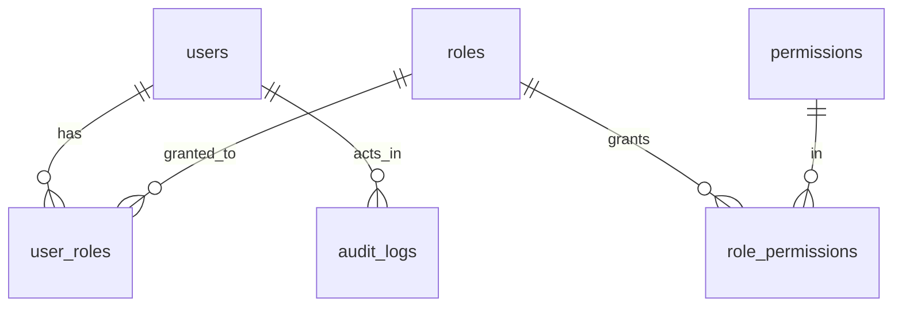
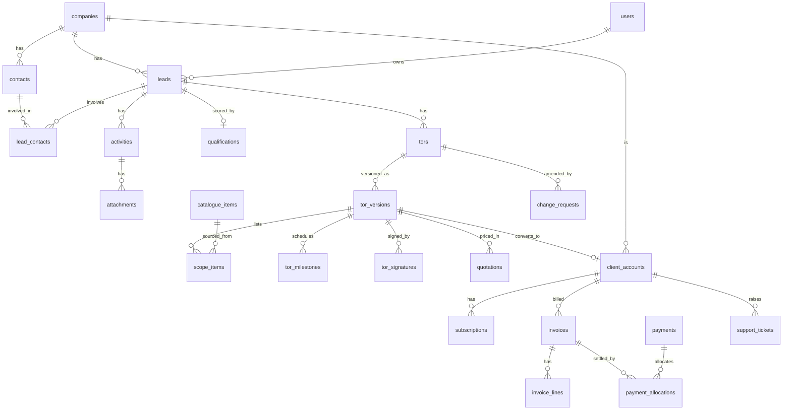

# 04 — Database design

Status legend: ✅ implemented and migrated · 🗓 designed, not yet created (arrives with its phase).

## Principles

- PostgreSQL, 3NF for transactional data; JSON only for genuinely document-like data (audit snapshots).
- UUID v7 primary keys (`uuid(7)`, time-ordered → friendlier to B-tree indexes than v4), `timestamptz(3)` timestamps, `snake_case` columns via `@map`.
- Foreign keys everywhere; **`ON DELETE RESTRICT`**, never cascade. History (audit, signed ToRs, invoices, payments) is preserved; users are disabled, not deleted.
- Money: `NUMERIC(14,2)` + explicit `currency` column (KES/USD) on every monetary row; arithmetic in the database or with a decimal library, never JS floats. Totals are computed, not stored, unless a documented snapshot is required (e.g. a sent ToR freezes its figures).
- Check constraints for rules Prisma cannot express are written by hand in the migration and marked `MANUAL`.
- Indexes follow identified query patterns (listed per table), not speculation.
- Concurrency: optimistic `version` integer on mutable aggregates that users edit concurrently (leads, ToR drafts) — added with those tables.

## ER diagram

Target model (🗓), shown separately so implemented tables stay accurate:

> **Step 5 (user administration) required no schema change.** `permissions` and `role_permissions` are now populated by `pnpm db:seed` (7 grants, all Director). Locks: user changes that can alter _who is an active Director_ take one transaction-scoped advisory lock (`pg_advisory_xact_lock(7204001)`) shared by the bootstrap CLI, role changes and disabling.

## Implemented tables (✅ migrations include identity/access/audit, sessions/refresh tokens, users/invitations, initial leads, `20261108100000_lead_lifecycle`, and `20261108140000_lead_capture_completion`)

| Table              | Purpose                                                                                                       | Key constraints                                                                                                                                                                                                                                        | Indexes (query pattern)                                                                                                                                                                                |
| ------------------ | ------------------------------------------------------------------------------------------------------------- | ------------------------------------------------------------------------------------------------------------------------------------------------------------------------------------------------------------------------------------------------------ | ------------------------------------------------------------------------------------------------------------------------------------------------------------------------------------------------------ |
| `users`            | Sign-in identities                                                                                            | PK uuid; `email` UNIQUE; CHECK email = lower(email); CHECK ACTIVE ⇒ password set; status enum                                                                                                                                                          | unique(email) — login lookup                                                                                                                                                                           |
| `roles`            | Role definitions (data)                                                                                       | `key` UNIQUE; CHECK key `^[a-z][a-z0-9_]*$`; `is_system`                                                                                                                                                                                               | unique(key)                                                                                                                                                                                            |
| `permissions`      | Capability keys (`resource:action`)                                                                           | `key` UNIQUE; CHECK format                                                                                                                                                                                                                             | unique(key)                                                                                                                                                                                            |
| `role_permissions` | role ⇄ permission (M:N)                                                                                       | composite PK; both FKs RESTRICT                                                                                                                                                                                                                        | (permission_id) — "which roles hold X"                                                                                                                                                                 |
| `user_roles`       | user ⇄ role (M:N)                                                                                             | composite PK; both FKs RESTRICT                                                                                                                                                                                                                        | (role_id) — "users with role X"                                                                                                                                                                        |
| `sessions`         | One sign-in on one device; referenced by the access token's `sid` and checked on every request                | PK uuid; user FK RESTRICT; CHECK expires_at > created_at; CHECK revoked_reason ⇒ revoked_at; `mfa_verified_at` (NULL = second factor not verified)                                                                                                     | (user_id, revoked_at) — active sessions of a user, revoke-all                                                                                                                                          |
| `refresh_tokens`   | One refresh token per row; a session is its own token family (migration `…_refresh_tokens`)                   | PK uuid; session FK RESTRICT; `token_hash` UNIQUE + CHECK 64 lower-hex (SHA-256, never the raw token); CHECK expires_at > created_at, used_at ≥ created_at; **partial UNIQUE (session_id) WHERE used_at IS NULL** = at most one live token per session | (session_id)                                                                                                                                                                                           |
| `audit_logs`       | Append-only audit trail; `category` BUSINESS (same transaction as the change) or SECURITY (standalone events) | PK uuid; actor FK RESTRICT (nullable for system actions); **trigger rejects UPDATE/DELETE/TRUNCATE**                                                                                                                                                   | (entity_type, entity_id, occurred_at DESC) — entity history; (actor_user_id, occurred_at DESC) — user activity; (occurred_at DESC) — recent feed; (category, occurred_at DESC) — security-event review |

### Normalisation and design decisions

- **Roles as rows, permissions as rows, two junction tables** — permissions are never duplicated per role or per user; one person may hold several roles (e.g. Director + Technical Lead, which is Augustine's real situation).
- **`audit_logs.old_values/new_values` are `jsonb`**: snapshots are document-like, differ per entity and are never filtered relationally. `entity_id` is `text` (not a FK) so one table can audit every entity type, including deleted ones.
- **Audit immutability in the database**, not just the app: a trigger raises on UPDATE/DELETE/TRUNCATE. Triggers do not stop the table owner or a superuser, so ✅ the API connects as `autonova_app` (INSERT/SELECT only on `audit_logs`; created by migration, no DDL) while migrations run as the owner ([06](06-security-and-access-control.md#database-enforcement)). ✅ `audit_logs.category` added. Default privileges grant DML on future tables to `autonova_app`; a migration adding an immutable table must revoke explicitly. Consequence: audit rows can't be purged by a script; retention (Kenya DPA) must be a deliberate, documented procedure (open decision).
- **Users never hard-deleted**: audit and (later) leads/ToRs/payments reference them (PRD: "records created by users who later become inactive").
- Password hash column is nullable so an `INVITED` user can exist before setting a password.
- **Seed**: the four system roles (idempotent). Permissions and grants are intentionally _not_ seeded until the permission matrix "Confirm" cells are approved ([06](06-security-and-access-control.md)).

## Planned tables and the data-integrity questions they must answer (🗓)

| Concern (directive §5.2)                       | Decision                                                                                                                                                                                                                                                                                          |
| ---------------------------------------------- | ------------------------------------------------------------------------------------------------------------------------------------------------------------------------------------------------------------------------------------------------------------------------------------------------- |
| Duplicate leads / companies                    | Never a hard unique on name. Implemented on leads as indexed `phone_normalized` (digits, international form) and `company_name_normalized`; the API **detects and warns** (409 until acknowledged), unless Q4 says block. Hard unique only on KRA PIN (partial unique, where not null).           |
| Multiple contacts per company                  | `contacts.company_id` FK; no contact data duplicated into leads; `lead_contacts` junction for contacts involved in a deal.                                                                                                                                                                        |
| Multiple deals per company                     | `leads.company_id` FK (1 company : N leads). Company nullability depends on Q3.                                                                                                                                                                                                                   |
| Pipeline state                                 | One `LeadStage` enum on leads plus separate `lost_reason`, `disqualification_reason`, and `revisit_on`; transitions are recorded in append-only `lead_stage_history` with actor, reason, source, and time. `DISQUALIFIED` is currently represented as a stage pending product confirmation of Q1. |
| ToR versions                                   | `tors` (identity per lead) → `tor_versions` (immutable snapshots v1,v2…) → `scope_items`. Editing a draft mutates the draft version only.                                                                                                                                                         |
| Signed document immutability                   | `tor_versions.status = SIGNED` + `signed_at`; DB trigger rejects UPDATE/DELETE on a signed version and its `scope_items`/`milestones`; PDF stored with SHA-256 hash of the exact signed content. Changes ⇒ `change_requests` → new version.                                                       |
| Both-party signatures                          | `tor_signatures(tor_version_id, party ENUM{AUTONOVA, CLIENT}, …)` UNIQUE(tor_version_id, party). Conversion requires both rows.                                                                                                                                                                   |
| One client per conversion                      | `client_accounts.signed_tor_version_id` UNIQUE ⇒ idempotent conversion. Multi-deal companies: open (Q21).                                                                                                                                                                                         |
| Invoice balances                               | Balance = invoice total − Σ allocations (computed). Not stored.                                                                                                                                                                                                                                   |
| Partial payments / one payment across invoices | `payments` (money received) + `payment_allocations` (payment ⇄ invoice, amount). CHECK allocations > 0; trigger/constraint prevents over-allocation. Allocation policy pending Q24–25.                                                                                                            |
| Concurrent updates                             | `version` column + `WHERE id = $1 AND version = $2` (optimistic lock) on leads and draft ToRs.                                                                                                                                                                                                    |
| Currency/VAT                                   | `currency` enum on every money row; VAT rate stored per ToR/invoice line as a snapshot (rate may change later); exempt flag. Rounding rule pending Q17.                                                                                                                                           |
| Soft delete / archival                         | Business records are archived (`archived_at`), not deleted; Director "delete" (PRD) = archive. Financial/contractual rows are never deletable.                                                                                                                                                    |

## Migration strategy

- Prisma Migrate. One migration per schema change, named for intent. Generate with `prisma migrate dev --create-only`, review SQL, add `MANUAL` constraints/triggers in the same file, then apply.
- Every migration file starts with a header: **Reason / Impact / Recovery**.
- Production: `prisma migrate deploy` only. Never `migrate reset` or destructive recreate without explicit authorisation.
- Destructive or enum-changing migrations use expand → backfill → contract across releases.
- CI/e2e: the e2e suite creates a fresh database and applies all migrations from zero (verifies the chain), and `prisma migrate diff --exit-code` detects schema/migration drift.
- Backups (PRD §8.4): daily, 30-day retention — operational task for Phase 10; RPO/RTO are open.

### Lead capture completion (`20261108140000_lead_capture_completion`)

- `leads.product_interest` is the `ProductInterest` enum; unmatched legacy text is preserved in `leads.legacy_product_interest`.
- `leads.phone_normalized` / `leads.company_name_normalized` (CHECK-constrained, indexed) support duplicate warnings; rules in `domain/lead-duplicates.ts`, mirrored in the migration backfill.
- `lead_reminders`: one delivery record per `(lead_id, due_at)` (UNIQUE); status/attempt/reason CHECKs keep SENT ⇔ `sent_at` and require a reason for FAILED/SKIPPED; the app role cannot DELETE or TRUNCATE it.
